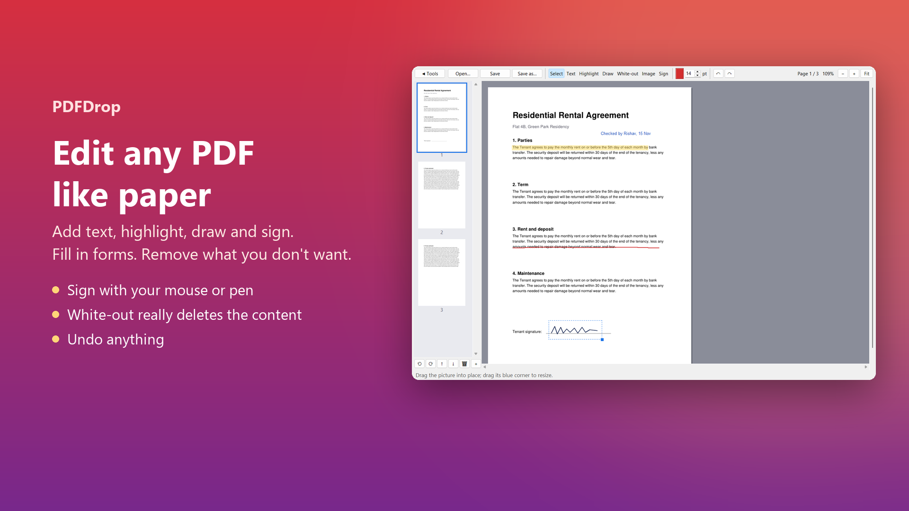

# PDFDrop

An **offline PDF toolkit and editor** for Windows 10 and 11. Your documents never leave your PC.



**Edit:** add text, highlight, draw, sign (draw your signature once and reuse it), insert pictures, white-out (really removes the content underneath), fill in forms, and rotate, reorder, delete or add pages. Undo and redo everything.

**Tools:** merge PDFs and images · split or extract pages · compress · rotate · images → PDF · PDF → JPG/PNG · add or remove a password · page numbers · watermark.

## Get it

- **Microsoft Store:** search "PDFDrop" (7-day free trial)
- **Direct download:** https://tiger1247.github.io

## Run from source

```bash
python -m venv build\venv
build\venv\Scripts\pip install pymupdf pillow tkinterdnd2
build\venv\Scripts\python src\main.py
```

Packaging: `packaging\build_msix.py` (Microsoft Store) and `packaging\build_portable.py` (download zip).

## Licence

PDFDrop is free software under the [GNU AGPL v3](LICENSE), because it is built on [PyMuPDF/MuPDF](https://github.com/pymupdf/PyMuPDF). See [THIRD_PARTY_NOTICES.txt](THIRD_PARTY_NOTICES.txt) and the [privacy policy](PRIVACY.md).
